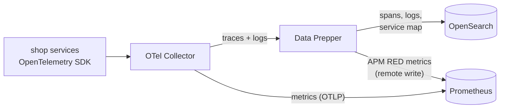
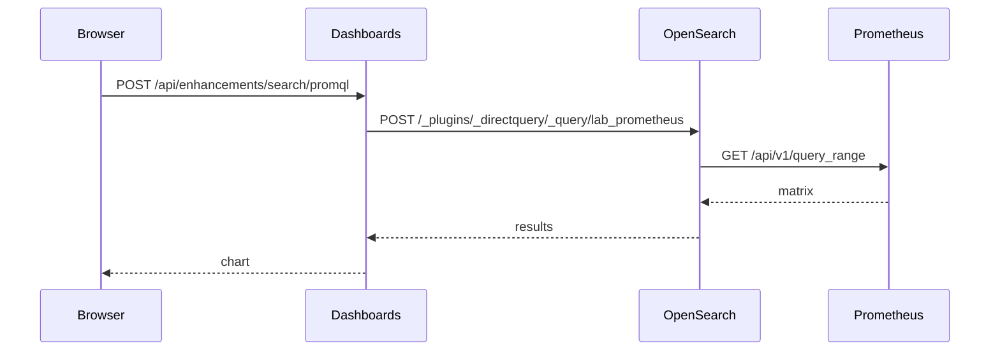
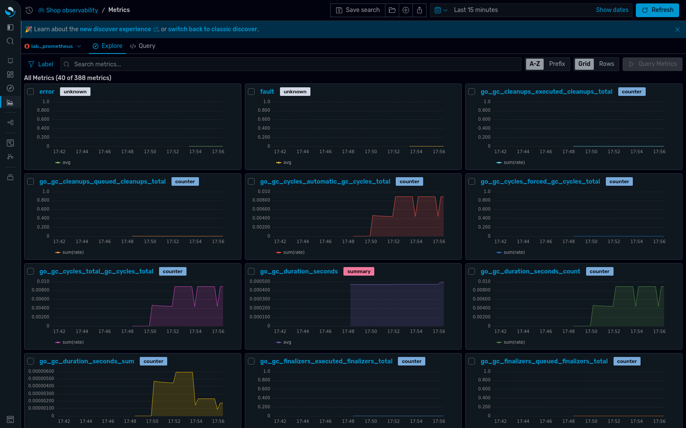
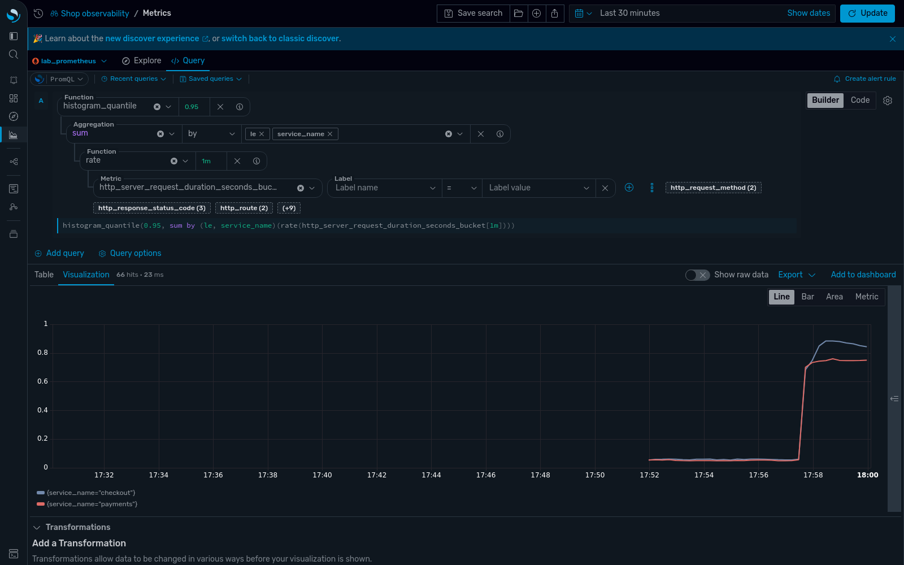
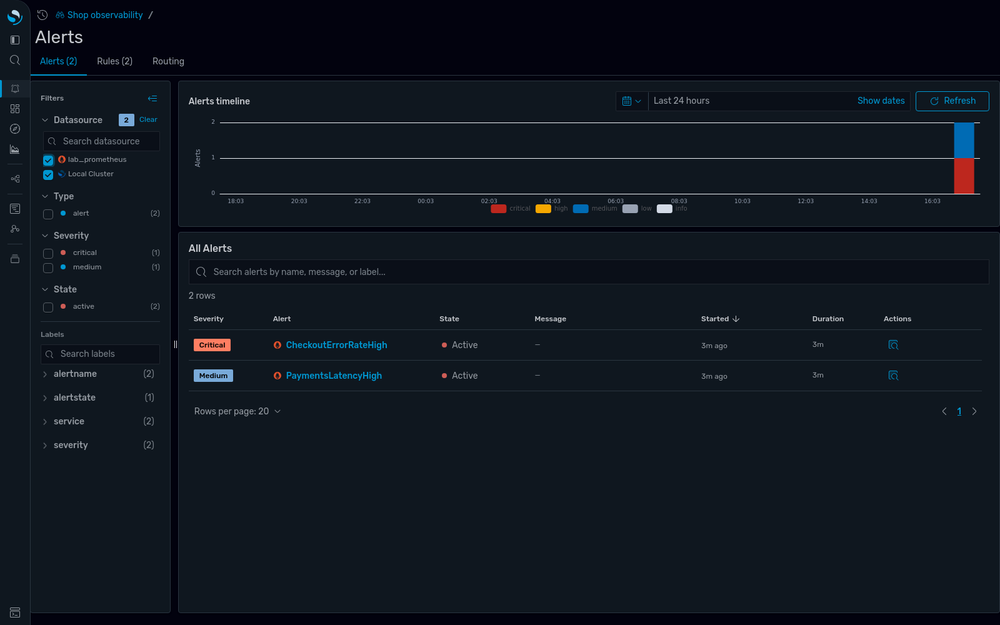
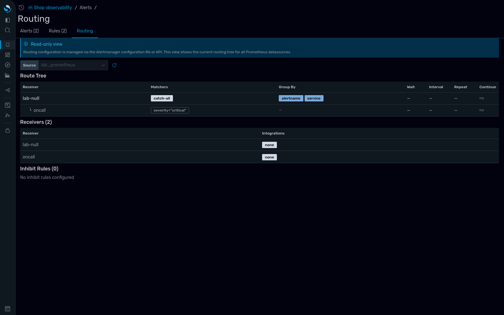
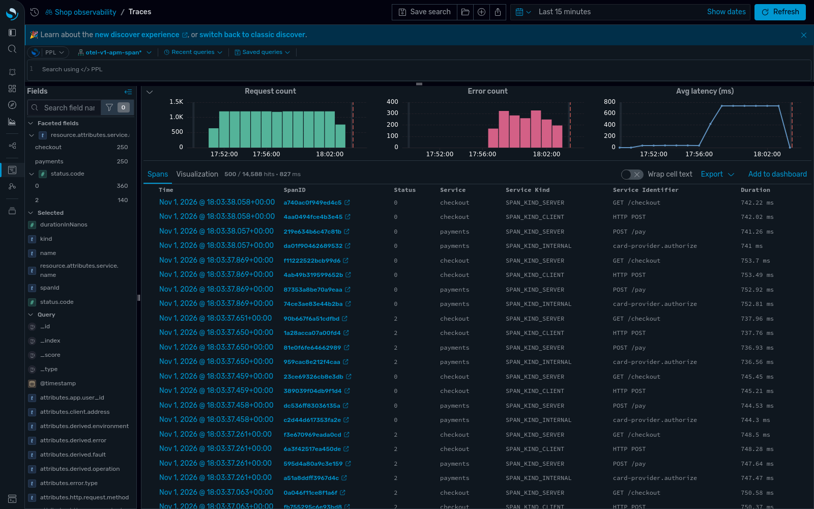
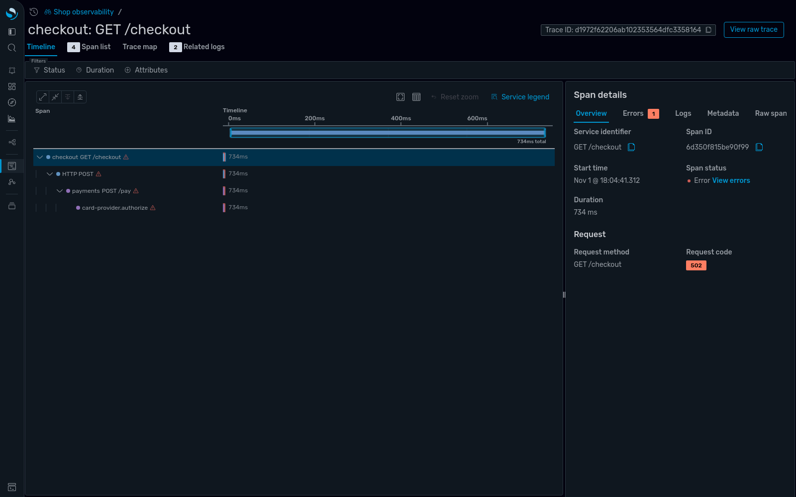
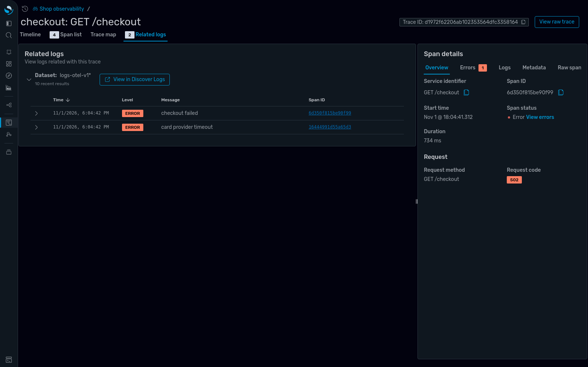
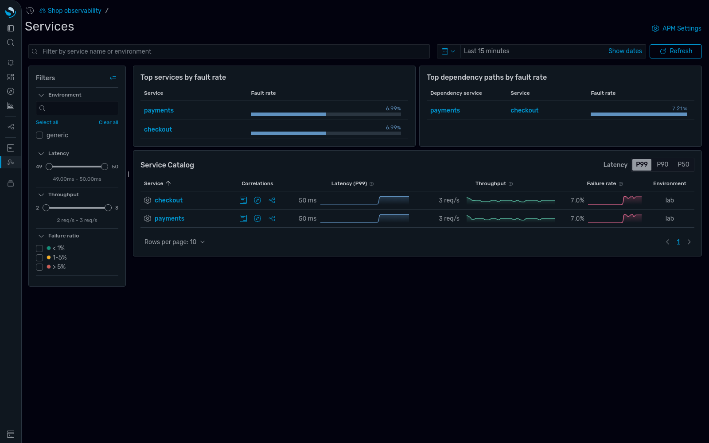

# One Engine for Logs, Metrics and Traces? Testing OpenSearch's New Prometheus Integration

*Draft blog post. Every number and screenshot below comes from the lab in this repository, run on a laptop with
OpenSearch 3.9.0, OpenSearch Dashboards 3.9.0, Data Prepper 2.16.0, Prometheus 3.15.1 and the OpenTelemetry
Collector 0.164.0.*

---

Over the last few releases OpenSearch has added a lot of Prometheus support:

- **3.5** added PromQL autocomplete and a metrics experience in Discover.
- **3.7** introduced the native Prometheus integration.
- **3.8** added "create an alert rule from a PromQL query".

The pitch is attractive: logs, traces **and** metrics in one place. But few people have run it end to end yet, so
we built a small, reproducible lab, broke a service on purpose, and tried to debug it using only OpenSearch Dashboards.

**Short answer:** it is *one pane*, not *one engine*. Your metrics stay in Prometheus, and OpenSearch queries them
live with real PromQL. That turned out to be a good design. The investigation flow works well. We also hit three
sharp edges, which we document below so you don't have to rediscover them.

## The setup

A two-service "shop" written in Go and instrumented with the OpenTelemetry SDK:
- `checkout` calls `payments`.
- `payments` calls a fake card provider.
- A load generator sends 5 requests per second.
- `payments` has a `/chaos` endpoint that adds latency and errors.



The Collector is the fork in the road:
- **Traces and logs** go through Data Prepper into OpenSearch indices (`otel-v1-apm-span-*`, `logs-otel-v1-*`).
- **Metrics** go straight into Prometheus through its native OTLP receiver (`--web.enable-otlp-receiver`).
- **Data Prepper** also derives request, error and duration ("RED") metrics from the spans and remote-writes them to Prometheus. This feeds the APM pages.

The whole lab is one `docker compose up` plus a setup script. See the [README](README.md).

## Connecting Prometheus

There is one API call. Dashboards registers a *direct query* data source:

```bash
curl -X POST localhost:5601/api/directquery/dataconnections -H 'osd-xsrf: true' -H 'Content-Type: application/json' -d '{
  "name": "lab_prometheus", "connector": "prometheus", "allowedRoles": [],
  "properties": { "prometheus.uri": "http://prometheus:9090",
                  "alertmanager.uri": "http://alertmanager:9093" } }'
```

The data source is not stored in Dashboards. It lives in **OpenSearch**, in the SQL plugin's data source registry.
That is also why the cluster needs `plugins.query.datasources.encryption.masterkey`: the connection settings are
encrypted at rest. You can see it with `GET _plugins/_query/_datasources`.

For the new UI you also need:
- an **Observability workspace**
- the explore flags in `opensearch_dashboards.yml` (`explore.enabled`, `explore.discoverMetrics.enabled`, `workspace.enabled`, ...).

Our `setup.sh` scripts all of it.

## Who actually talks to Prometheus?

This was the first thing we wanted to know. We recorded the browser's requests and then read the Dashboards server code.



**OpenSearch is the proxy**, not Dashboards. That gives you one place for credentials and access control. You can call it yourself:

```bash
curl -X POST localhost:9200/_plugins/_directquery/_query/lab_prometheus -H 'Content-Type: application/json' -d '{
  "query": "sum by (result) (rate(shop_orders_total[1m]))", "language": "promql",
  "options": { "queryType": "instant", "time": "'$(date +%s)'" } }'
```

The query is **real PromQL**, passed through as-is, not translated into a different query language.
Anything that works in the Prometheus UI or in your recording rules works here.

PPL can also read the Prometheus catalog (`source = lab_prometheus.shop_orders_total`), but aggregations need a time
span: `stats ... by result` fails with *"Prometheus Catalog doesn't support aggregations without span expression"*.
For metrics, PromQL is the language to use.

## The incident

With traffic flowing, we broke `payments`:

```bash
curl "localhost:8081/chaos?latency_ms=700&error_rate=0.25"
```

### 1. Metrics: something is wrong

**Discover → Metrics** in *Explore* mode found all 388 metric names in Prometheus without any configuration. It shows one
small chart per metric and labels each as counter, histogram or summary.



In *Query* mode, the **builder** and the **code editor** stay in sync. We typed the p95 latency query, and the
builder broke it into function → aggregation → function → metric. This is a great way to learn PromQL:

```promql
histogram_quantile(0.95, sum by (le, service_name) (rate(http_server_request_duration_seconds_bucket[1m])))
```



`service_name` exists as a label because Prometheus is told to promote that OTel resource attribute
(`otlp.promote_resource_attributes` in `prometheus.yml`). It is the same `service.name` that is stored on every
span and log in OpenSearch. **That shared key is what makes cross-signal correlation possible.** Plan it
deliberately in your own setup.

### 2. Alerts: Prometheus rules next to OpenSearch monitors

Both Prometheus alerting rules fired within about two minutes (each has `for: 1m`). The **Alerts** page lists them with severity, state
and labels, next to OpenSearch's own alerting monitors, filterable by data source:



The **Routing** tab renders Alertmanager's routing tree, read-only. It is handy for answering "who got paged for this?":



### 3. Traces: where is the time going?

**Discover → Traces** shows request count, error count and latency, computed from the spans stored in OpenSearch.
The latency step is obvious:



Opening a failed request shows the waterfall. Every span is about 734 ms, and the deepest one is
`card-provider.authorize`. That points straight at the culprit.



### 4. Logs: what exactly happened?

The **Related logs** tab on the same trace shows the two log lines written during that request. One is from each
service, and they are joined on `traceId`:



So we went from metric spike → alert → slow span → the exact error message without leaving one UI, and with metrics
never leaving Prometheus. **This is the integration at its best.**

## Three sharp edges

### 1. APM p99 latency was wrong in our setup

The **APM → Services** page said p99 latency was **50 ms**:



At that moment the real p95 was about 750 ms. The trace view above agrees with 750 ms, and so does the
OTel histogram in Prometheus. So the APM page was off by an order of magnitude.

We recorded the PromQL the page sends:

```promql
histogram_quantile(0.99, sum by (environment, service, le) (
  sum_over_time(latency_seconds_bucket{remoteService="", namespace="span_derived"}[15m]))) * 1000
```

Then we looked at the buckets Data Prepper had written:

| `le` | 0.025 | 0.05 | 0.075 | 0.1 | 0.25 | 0.5 | 0.75 | 1.0 | +Inf |
| --- | --- | --- | --- | --- | --- | --- | --- | --- | --- |
| count (15m) | 209 | 1492 | 94 | 0 | 0 | 0 | 1081 | 45 | **0** |

The buckets add up to exactly `latency_seconds_count` (3,197). In other words, they are **per-bucket counts**, and
`+Inf` is 0. Prometheus's `histogram_quantile` expects **cumulative** buckets, where `+Inf` equals the total.
Given per-bucket counts, it puts the 99th percentile in the wrong bucket.

The OTel-SDK histogram from the same requests is cumulative and gives the right answer.

Data Prepper's maintainers are already aware of related Prometheus-compatibility issues with these APM metrics
([data-prepper#6710](https://github.com/opensearch-project/data-prepper/issues/6710): delta temporality and series
identity). We did not find this bucket issue reported, so it is worth testing on your own versions before trusting
APM percentiles.

**Workaround:** use the OTel SDK histograms for latency SLOs and alerts, and treat the APM page as a topology and error-rate view.

### 2. "Create alert rule" needs a Prometheus that accepts rules over an API

The PromQL toolbar has a **Create alert rule** button. Saving it makes Dashboards call
`POST _plugins/_directquery/_resources/<ds>/api/v1/rules/<namespace>` on OpenSearch, which forwards it to the
data source's ruler endpoint. Vanilla Prometheus has no such endpoint: rules are files. Doing the same call by hand:

```json
{ "type": "PrometheusClientException", "reason": "Invalid Request",
  "details": "Ruler request failed with code: 404. Error details: 404 page not found" }
```

**Reading** rules works fine against vanilla Prometheus: the Alerts and Rules tabs show our file-based rules.
**Writing** rules needs a backend with a ruler API, such as Cortex, Mimir or Amazon Managed Service for Prometheus,
set as `prometheus.ruler.uri`. The official OpenSearch Observability Stack runs Cortex for this reason.

### 3. Datasets created through the API have no fields

We created the logs and traces datasets with the saved-objects API. Discover opened them, but every page showed
*"Could not locate that index-pattern-field (id: time)"*, and **Related logs** returned nothing.

The fix is to fetch the field list once with `GET /api/index_patterns/_fields_for_wildcard` and save it on the
dataset, which is what the UI wizard does. `setup.sh` does this. Run it after some data has arrived.

### Smaller notes

- **Data Prepper's APM metrics have generic names:** `request`, `error`, `fault`, `latency_seconds`. They are
  distinguished only by a `namespace="span_derived"` label. In a shared Prometheus, decide early whether that is
  acceptable.
- **Remote-written series carry no type metadata.** Explore labels them `unknown` and picks a default chart.
- **Collector 0.164 renamed exporters:** `otlp` became `otlp_grpc` and `otlphttp` became `otlp_http`. The old names
  still work but log deprecation warnings.
- **The Prometheus sink rejects plain `http://` URLs** unless you set `insecure: true`, even inside a Docker network.
  Data Prepper then refuses to start the whole pipeline.

## What it costs

Steady state at 5 requests per second, after about 15 minutes:

| Component | Memory |
| --- | --- |
| OpenSearch (1 GB heap) | 1.9 GB |
| Data Prepper | 470 MB |
| Dashboards | 390 MB |
| OTel Collector | 135 MB |
| Prometheus | 75 MB |
| Alertmanager + 3 Go services | about 65 MB |

OpenSearch held 18.5k spans (7 MB) and 7.3k log records (2.4 MB). Prometheus held about 1,300 active series.

## Verdict

**What "one engine" really means:** OpenSearch doesn't absorb your metrics. It becomes the **query broker** and the
**UI** for them. We think that is the right call:
- Prometheus keeps doing what it is best at.
- Your recording rules and alerting rules keep working.
- Nobody has to migrate data.

**What works today:**
- Discover Metrics with real PromQL, a builder that teaches it, and auto-discovery.
- The unified alerts and routing view.
- The trace → logs pivot.

**Before production, check:**
- whether you need **rule creation** from the UI. If you do, you need a Cortex, Mimir or AMP style backend.
- whether the **APM percentiles** match your SDK histograms.
- that **`service.name` is promoted** to a Prometheus label, so metrics can be joined to traces and logs.

If you already run Prometheus and OpenSearch side by side, this integration removes the second UI for very little
setup. That is the main win.

## Try it yourself

```bash
git clone https://github.com/mohiadeen-ameer/opensearch-prometheus-lab
cd opensearch-prometheus-lab
docker compose up -d --build
sleep 60 && ./setup.sh
curl "localhost:8081/chaos?latency_ms=700&error_rate=0.25"
```

Then open http://localhost:5601 and pick the **Shop observability** workspace.

## References

- [OpenSearch 3.5 release blog](https://opensearch.org/blog/opensearch-3-5-is-live/): PromQL autocomplete and metrics in Discover
- [Explore OpenSearch 3.7](https://opensearch.org/blog/explore-opensearch-3-7/): native Prometheus integration
- [What's new in OpenSearch 3.8](https://opensearch.org/blog/whats-new-in-opensearch-3-8/): alert rules from PromQL
- [Data Prepper 2.15: Prometheus metrics support](https://opensearch.org/blog/data-prepper-2-15-brings-apache-iceberg-ingestion-and-prometheus-metrics-support/)
- [OpenSearch Observability Stack](https://github.com/opensearch-project/observability-stack): the full reference deployment this lab simplifies
- [data-prepper#6710](https://github.com/opensearch-project/data-prepper/issues/6710): APM metrics and Prometheus compatibility
