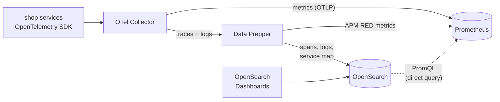

# OpenSearch + Prometheus lab

A small, reproducible lab for testing OpenSearch's native Prometheus integration (OpenSearch 3.7+). Logs and traces
are stored in OpenSearch, metrics are stored in Prometheus, and OpenSearch Dashboards queries all three from one UI.

The write-up of what I found is the blog post in **[blog-submission/](blog-submission/_posts/2026-11-01-testing-opensearch-prometheus-integration.md)**, formatted for opensearch.org (see [SUBMIT.md](blog-submission/SUBMIT.md)).



## Run it

You need Docker with about 4 GB of memory free.

```bash
docker compose up -d --build     # 9 containers, first build takes a few minutes
sleep 60                         # let some telemetry arrive
./setup.sh                       # connect Prometheus, create the workspace and datasets
```

`setup.sh` prints the workspace URL. You can also open http://localhost:5601 and pick **Shop observability**.

Break something:

```bash
curl "localhost:8081/chaos?latency_ms=700&error_rate=0.25"   # slow, failing payments
curl "localhost:8081/chaos"                                   # back to normal
```

Change the load (default 100 requests per second):

```bash
RPS=50 docker compose up -d loadgen
```

Stop and clean up:

```bash
docker compose down        # keep data
docker compose down -v     # delete data too
```

## What runs

| Container | Port | Role |
| --- | --- | --- |
| `opensearch` | 9200 | stores logs, spans and the APM service map; proxies PromQL to Prometheus |
| `dashboards` | 5601 | the UI (Discover logs/traces/metrics, APM, Alerts) |
| `prometheus` | 9090 | stores metrics; receives OTLP from the Collector and remote write from Data Prepper |
| `alertmanager` | 9093 | receives alerts from Prometheus; its routing tree shows up in Dashboards |
| `otel-collector` | 4317, 4318 | sends traces and logs to Data Prepper, and metrics to Prometheus |
| `data-prepper` | (internal) | writes spans and logs to OpenSearch; builds the service map and RED metrics |
| `checkout` | 8080 | demo service: `GET /checkout` calls payments |
| `payments` | 8081 | demo service: `POST /pay`; `GET /chaos` injects faults |
| `loadgen` | (none) | 100 requests per second to checkout (set `RPS` to change it) |

## Things to try in Dashboards

| Where | What |
| --- | --- |
| Discover → **Metrics** → Explore | every Prometheus metric with a preview chart, no setup |
| Discover → **Metrics** → Query | `histogram_quantile(0.95, sum by (le, service_name) (rate(http_server_request_duration_seconds_bucket[1m])))` |
| Discover → **Traces** | filter `status.code = 2`, open a span, then the **Related logs** tab |
| Discover → **Logs** | PPL: `source = logs-otel-v1* \| where severityText = 'ERROR' \| stats count() by resource.attributes.service.name` |
| **Alerts** | Prometheus rules `CheckoutErrorRateHigh`, `PaymentsLatencyHigh`, plus the Alertmanager **Routing** tab |
| **APM → Services** | service catalog with RED metrics |

The same PromQL from the command line, through OpenSearch:

```bash
curl -s -X POST localhost:9200/_plugins/_directquery/_query/lab_prometheus -H 'Content-Type: application/json' -d '{
  "query": "sum by (result) (rate(shop_orders_total[1m]))", "language": "promql",
  "options": { "queryType": "instant", "time": "'$(date +%s)'" } }'
```

## Files

| File | What it does |
| --- | --- |
| `docker-compose.yml` | the 9 containers and their versions |
| `config/otel-collector.yaml` | splits signals: traces and logs → Data Prepper, metrics → Prometheus |
| `config/data-prepper/pipelines.yaml` | logs → `logs-otel-v1-*`, spans → `otel-v1-apm-span-*`, service map + RED metrics |
| `config/prometheus.yml` | OTLP receiver settings, `service.name` promoted to a label, rules, Alertmanager |
| `config/prometheus-rules.yml` | one recording rule and two alerts |
| `config/alertmanager.yml` | a small routing tree so the Routing tab has something to show |
| `config/opensearch_dashboards.yml` | turns on workspaces, the explore plugin (logs/traces/metrics) and Alertmanager view |
| `setup.sh` | Prometheus data source, workspace, datasets (with field refresh), trace-to-logs and APM correlations |
| `benchmark/` | `run.py` measures the lab at given request rates (`benchmark/run.py 100`); `results.json` is the latest run |
| `app/` | the Go demo: `main.go` (3 roles), `telemetry.go` (OTel SDK setup) |

## Versions tested

OpenSearch 3.9.0, OpenSearch Dashboards 3.9.0, Data Prepper 2.16.0, Prometheus 3.15.1, Alertmanager 0.34.2,
OpenTelemetry Collector Contrib 0.164.0, Go 1.27, OpenTelemetry Go 1.47.0.

Security is disabled and everything is single-node. This is a lab, not a production template.
For a full deployment, see the official [OpenSearch Observability Stack](https://github.com/opensearch-project/observability-stack).
